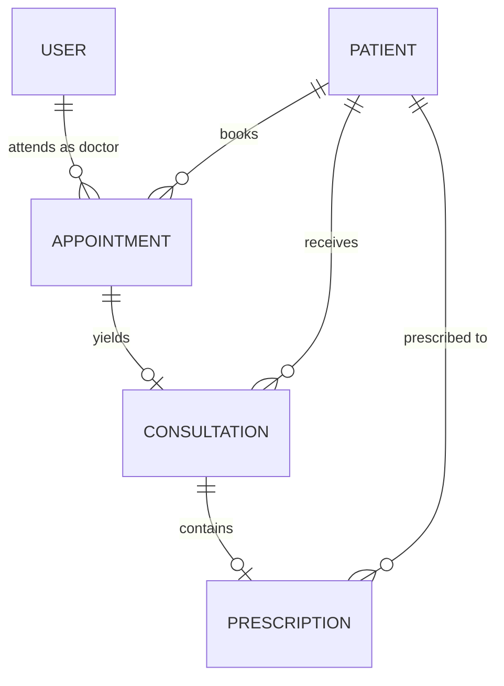

# MediFlow — Canonical Data Models & Database Schemas

**Document Version:** 1.0.0  
**Status:** Approved Baseline  
**Integration Owner:** Product Owner / Team Lead  
**Database Engine:** MongoDB Atlas via Mongoose ODM  

---

## 1. Domain Entities & Relationships Overview

MediFlow enforces strict referential integrity through Mongoose schemas residing exclusively in `src/models/`.

---

## 2. Canonical Model Specifications

### 2.1 User Model (`src/models/User.ts`)
Represents clinic staff (Admins, Doctors, Receptionists) and registered Patients.

| Field | Type | Modifiers / Constraints | Description |
|---|---|---|---|
| `_id` | ObjectId | Auto-generated | MongoDB primary identifier |
| `name` | String | Required, Trimmed | Full name of the user |
| `email` | String | Required, Unique, Lowercase, Indexed | Login email |
| `passwordHash` | String | Required | Bcrypt salted hash |
| `role` | String | Enum: `['ADMIN', 'DOCTOR', 'RECEPTIONIST', 'PATIENT']`, Default: `'PATIENT'` | System RBAC authorization role |
| `specialization` | String | Optional, Trimmed | Medical specialty (Doctors only) |
| `phone` | String | Optional, Trimmed | Contact phone number |
| `isActive` | Boolean | Default: `true`, Indexed | Account activation flag |
| `createdAt` | Date | Auto-managed by Mongoose | Timestamp |
| `updatedAt` | Date | Auto-managed by Mongoose | Timestamp |

**Indexes**:
- `{ email: 1 }` (Unique)
- `{ role: 1, isActive: 1 }`

---

### 2.2 Patient Model (`src/models/Patient.ts`)
Represents outpatient medical records registered within MediFlow.

| Field | Type | Modifiers / Constraints | Description |
|---|---|---|---|
| `_id` | ObjectId | Auto-generated | Primary identifier |
| `patientId` | String | Required, Unique, Indexed | Formatted Clinic ID: `MED-YYYY-XXXXX` |
| `fullName` | String | Required, Trimmed | Patient's legal name |
| `dateOfBirth` | Date | Required | Birth date for age calculations |
| `gender` | String | Enum: `['MALE', 'FEMALE', 'OTHER']`, Required | Gender |
| `phone` | String | Required, Trimmed, Indexed | Primary contact number |
| `email` | String | Optional, Lowercase, Trimmed | Contact email |
| `bloodGroup` | String | Enum: `['A+', 'A-', 'B+', 'B-', 'AB+', 'AB-', 'O+', 'O-']` | Blood type |
| `allergies` | [String] | Default: `[]` | Documented medical allergies |
| `emergencyContact` | Subdocument | Required: `{ name: String, relationship: String, phone: String }` | Emergency notification contact |
| `address` | Subdocument | Optional: `{ street: String, city: String, state: String, zipCode: String }` | Residential address |
| `userId` | ObjectId | Optional, Ref: `'User'` | Linked user account (if registered for portal) |
| `createdAt` | Date | Auto-managed | Registration timestamp |
| `updatedAt` | Date | Auto-managed | Last update timestamp |

**Indexes**:
- `{ patientId: 1 }` (Unique)
- `{ phone: 1 }`
- `{ fullName: "text", phone: "text" }` (Full-text search)

---

### 2.3 Appointment Model (`src/models/Appointment.ts`)
Represents scheduled and completed clinic visits.

| Field | Type | Modifiers / Constraints | Description |
|---|---|---|---|
| `_id` | ObjectId | Auto-generated | Primary identifier |
| `patientId` | ObjectId | Ref: `'Patient'`, Required, Indexed | The scheduled patient |
| `doctorId` | ObjectId | Ref: `'User'`, Required, Indexed | Assigned consulting doctor |
| `dateTime` | Date | Required, Indexed | Scheduled date and time |
| `status` | String | Enum: `['SCHEDULED', 'CONFIRMED', 'IN_PROGRESS', 'COMPLETED', 'CANCELLED', 'NO_SHOW']`, Default: `'SCHEDULED'` | Workflow status |
| `reason` | String | Required, Trimmed | Visit complaint / reason for visit |
| `queueNumber` | Number | Optional | Daily queue token |
| `notes` | String | Optional, Trimmed | Administrative notes |
| `createdAt` | Date | Auto-managed | Creation timestamp |
| `updatedAt` | Date | Auto-managed | Update timestamp |

**Indexes**:
- `{ doctorId: 1, dateTime: 1 }`
- `{ patientId: 1, dateTime: -1 }`
- `{ status: 1, dateTime: 1 }`

---

### 2.4 Consultation Model (`src/models/Consultation.ts`)
Represents doctor clinical examination records.

| Field | Type | Modifiers / Constraints | Description |
|---|---|---|---|
| `_id` | ObjectId | Auto-generated | Primary identifier |
| `appointmentId` | ObjectId | Ref: `'Appointment'`, Required, Unique, Indexed | 1-to-1 link with appointment |
| `patientId` | ObjectId | Ref: `'Patient'`, Required, Indexed | Patient record |
| `doctorId` | ObjectId | Ref: `'User'`, Required, Indexed | Attending physician |
| `vitals` | Subdocument | `{ bloodPressureSystolic: Number, bloodPressureDiastolic: Number, heartRate: Number, temperature: Number, weight: Number, height: Number, spo2: Number }` | Recorded vital signs |
| `chiefComplaint` | String | Required, Trimmed | Primary symptom reported |
| `symptoms` | [String] | Default: `[]` | Array of clinical symptoms |
| `diagnosis` | String | Required, Trimmed | Clinical diagnosis |
| `clinicalNotes` | String | Optional, Trimmed | Detailed doctor observations |
| `status` | String | Enum: `['DRAFT', 'COMPLETED']`, Default: `'COMPLETED'` | Consultation lock status |
| `createdAt` | Date | Auto-managed | Examination timestamp |
| `updatedAt` | Date | Auto-managed | Update timestamp |

**Indexes**:
- `{ appointmentId: 1 }` (Unique)
- `{ patientId: 1, createdAt: -1 }`

---

### 2.5 Prescription Model (`src/models/Prescription.ts`)
Represents medications prescribed during a consultation.

| Field | Type | Modifiers / Constraints | Description |
|---|---|---|---|
| `_id` | ObjectId | Auto-generated | Primary identifier |
| `consultationId` | ObjectId | Ref: `'Consultation'`, Required, Indexed | Associated consultation |
| `patientId` | ObjectId | Ref: `'Patient'`, Required, Indexed | Patient receiving prescription |
| `doctorId` | ObjectId | Ref: `'User'`, Required, Indexed | Prescribing physician |
| `medications` | [Subdocument] | Required array of `{ name: String, dosage: String, frequency: String, durationDays: Number, instructions: String }` | Prescribed drugs |
| `generalInstructions` | String | Optional, Trimmed | Dietary or lifestyle notes |
| `createdAt` | Date | Auto-managed | Date prescribed |
| `updatedAt` | Date | Auto-managed | Update timestamp |

**Indexes**:
- `{ consultationId: 1 }`
- `{ patientId: 1, createdAt: -1 }`

---

## 3. Data Integrity & Validation Rules

1. **Server Validation First**: Every Mongoose model has a corresponding Zod schema located in `src/lib/validation/`. API requests validate via Zod prior to database persistence.
2. **Synthetic Data Policy**: Only synthetic test fixtures may be used for testing, CI runs, and demos. No real patient data is permitted.
3. **No Duplicate Models**: All entities must import canonical schemas from `src/models/`. Feature folders must never construct independent Mongoose models.
